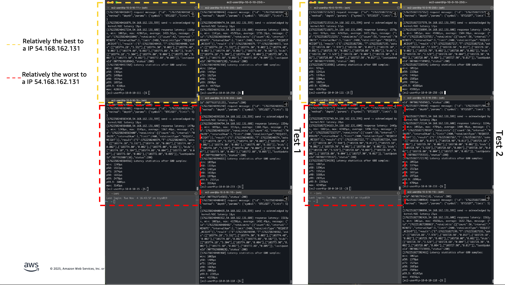
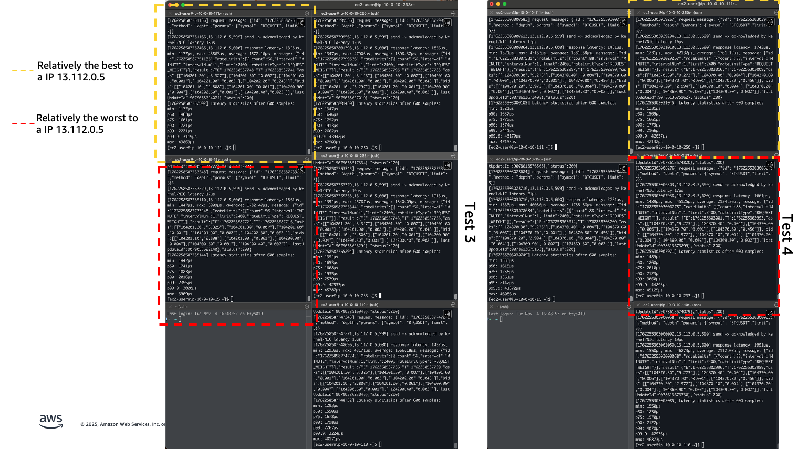
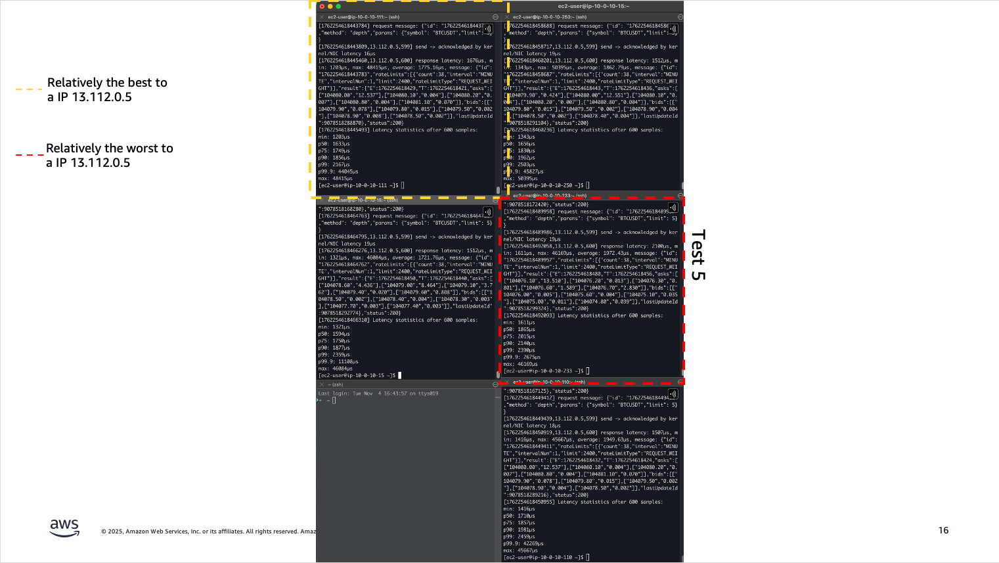

# Binance WebSocket EC2 Hunting

EC2 Hunting for Binance Futures WebSocket API latency using AWS EC2 instances with partition placement groups.

## Overview

This project deploys 7 x `c6in.2xlarge` to measure WebSocket latency to Binance Futures API endpoints. The Rust client connects to specific Binance IPs and measures round-trip latency for market data requests using nanosecond-accurate monotonic timestamping.

### The Hunting Path


### Result




### Architecture

- **EC2 Instances**: 7x c6in.2xlarge instances in partition placement group
- **Placement Strategy**: Partition placement group for network isolation
- **Region**: ap-northeast-1 (Tokyo)
- **Performance Optimizations**:
  - Hyper-threading disabled
  - Turbo boost disabled
  - CPU governor set to performance mode
  - CPU isolation (cores 0-1) for benchmark workload

## Prerequisites

- Terraform >= 1.0
- AWS CLI configured with appropriate credentials
- [Session Manager plugin](https://docs.aws.amazon.com/systems-manager/latest/userguide/session-manager-working-with-install-plugin.html) for AWS CLI
- Rust toolchain (for local testing)
- jq (for parsing JSON outputs)

## Local Testing

Test the Rust WebSocket client locally before deployment:

```bash
cd sources/binance_ws

# Find Binance Futures WebSocket IPs
dig +short ws-fapi.binance.com

# Run with specific target IP
cargo run <target_ip_address>
```

The client will:
- Connect to the specified Binance IP
- Send orderbook depth requests every second
- Measure latency (min/max/avg/percentiles)
- Exit after 600 samples with statistics

## Deployment

### 1. Package Source Code

```bash
sh pack_source.sh
```

This creates `sources/source.tar.gz` containing the Rust project.

### 2. Configure Variables

Copy the example tfvars file and fill in your environment-specific values:

```bash
cp terraform.tfvars.example terraform.tfvars
```

Edit `terraform.tfvars` with your values:
- `aws_vpc_id`: Your target VPC ID
- `aws_availability_zone_id`: Target availability zone
- `s3_bucket`: S3 bucket for source code distribution

See `variables.tf` for all available options.

### 3. Deploy Infrastructure

```bash
terraform init
terraform apply --auto-approve
```

This provisions:
- Partition placement group with 7 partitions
- VPC subnet, internet gateway, and routing
- Security group (SSH access from your IP)
- S3 VPC endpoint
- IAM roles and instance profiles
- EC2 instances with cloud-init scripts

The EC2 will run the `scripts/client.sh` automatically to 
- setup basic Kernel optimization and isolate `0-1` CPU for running the Rust program
- download Rust program from S3 and build the Rust program binary


### 4. Access Instances

Instances are accessed via AWS SSM Session Manager (no SSH keys or open ports needed).

Login to specific instances:

```bash
# List instance IDs
terraform output -json instance_id_and_partition_id_mapping

# Start a session to a specific instance
aws ssm start-session --target <instance-id> --region ap-northeast-1
```

Run the Rust program simultaneously on all instances:
```bash
TARGET_IP=<target_ip_address>

# Run on a single instance via SSM session
sudo nohup taskset -c 0-1 /share/bench/sources/binance_ws/target/release/binance_ws $TARGET_IP > "/home/ec2-user/$(ec2-metadata -i | awk '{print $2}').log" 2>&1 &

# Or run on all instances at once via SSM send-command
INSTANCE_IDS=$(terraform output -json instance_id_and_partition_id_mapping | jq -r 'keys[]')
aws ssm send-command \
  --targets "Key=instanceids,Values=$(echo $INSTANCE_IDS | tr ' ' ',')" \
  --document-name "AWS-RunShellScript" \
  --parameters "commands=['sudo nohup taskset -c 0-1 /share/bench/sources/binance_ws/target/release/binance_ws $TARGET_IP > /home/ec2-user/\$(ec2-metadata -i | awk \"{print \\$2}\").log 2>&1 &']" \
  --region ap-northeast-1
```


### 5. View Results

Check benchmark logs on each instance:

```bash
# View running log
tail -f /home/ec2-user/$(ec2-metadata -i | awk '{print $2}').log

# View cloud-init logs
cat /var/log/cloud-init-output.log
```

### 6. Destroy Infrastructure

```bash
terraform destroy --auto-approve
```

## Benchmark Configuration

The Rust client (`sources/binance_ws/src/main.rs`) performs:

1. **Connection**: Connects to specified Binance IP via WebSocket
2. **Warm-up**: Skips first 5 requests
3. **Measurement**: Records 600 samples with 1-second intervals
4. **Metrics**: Tracks min, max, average, and percentiles (p50, p75, p90, p99, p99.9)
5. **Request**: Depth data for BTCUSDT with 5 levels


## Outputs

- `instance_public_ip_client_ppg`: Public IPs of all instances
- `instance_id_and_partition_id_mapping`: Instance-to-partition mapping

## Troubleshooting

### Cloud-init Issues

```bash
cat /var/log/cloud-init-output.log
```

### Check Running Process

```bash
ps aux | grep binance_ws
```

### Verify CPU Configuration

```bash
# Check hyper-threading status
cat /sys/devices/system/cpu/cpu*/topology/thread_siblings_list

# Check CPU governor
cat /sys/devices/system/cpu/cpu*/cpufreq/scaling_governor

# Check turbo boost
cat /sys/devices/system/cpu/intel_pstate/no_turbo
```

## Project Structure

```
.
├── main.tf                    # Main Terraform configuration
├── variables.tf               # Variable definitions
├── providers.tf               # AWS provider configuration
├── pack_source.sh            # Script to package Rust source
├── scripts/
│   ├── client.sh             # EC2 initialization script
│   └── cloud-config.yaml     # Cloud-init configuration
└── sources/
    └── binance_ws/           # Rust WebSocket client
        ├── Cargo.toml
        └── src/
            └── main.rs       # Main benchmark logic
```

## Notes

- Target IP is hardcoded in `scripts/client.sh` - update before deployment
- Benchmark runs automatically on instance boot
- Results are logged to `/home/ec2-user/<instance-id>.log`
- Process exits after 600 samples (~10 minutes)