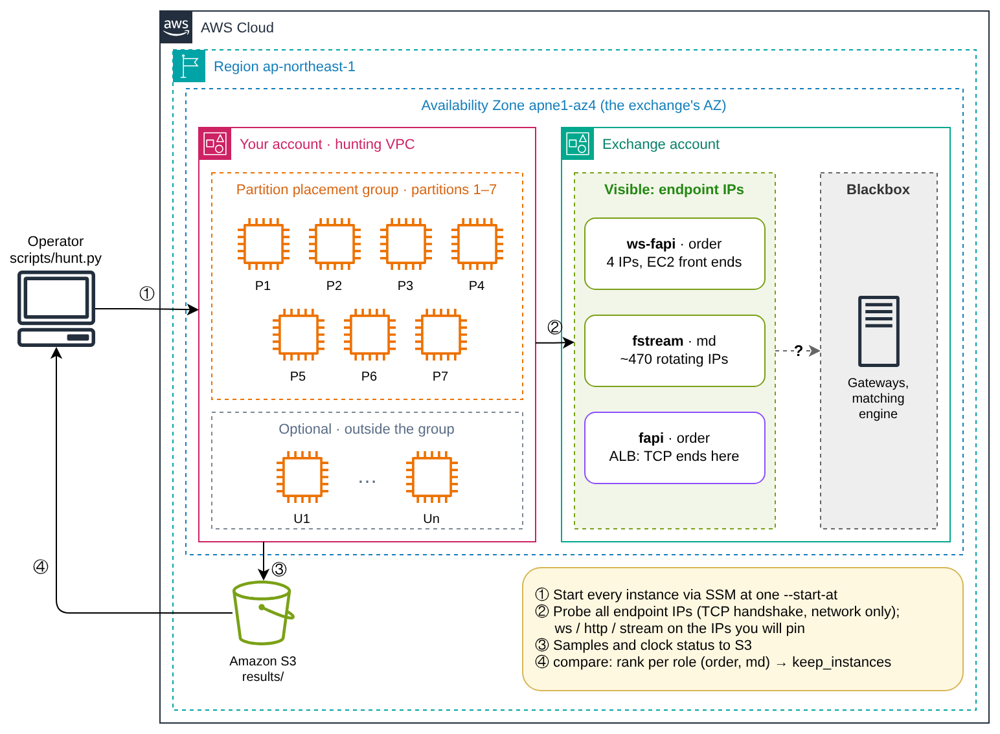

# CEX WebSocket EC2 Hunting

Find the EC2 host with the lowest network latency to a crypto exchange: launch a fleet across a partition placement group in the exchange's Availability Zone, measure every instance against the exchange's endpoints at the same moments, rank them, and keep the winner as the production host.



P1–P7 are one instance per partition. U1 … Un are optional instances outside the group (any number, default 0): EC2 places them anywhere in the AZ, so each is one more placement draw that may land on racks the partitions don't cover. What the fleet can measure ends at the exchange's endpoint IPs; what sits behind them is a black box. Diagram source: `assets/hunting-path.drawio`.

How it measures, in short ([details](docs/measurement.md)):
- Ranks by TCP handshake RTT to every endpoint IP (network only, same protocol as real traffic), separately for order entry and market data.
- All instances sample on one time grid, and each sample is compared with the fleet median at that moment, so load swings on the exchange side cancel out.
- WebSocket and HTTP round trips confirm the ranking on the production path. Samples go to S3 and are analysed offline.
- Hosts are tuned for quiet measurement: SMT off, isolated cores, interrupts on housekeeping cores, `idle=poll`, `clocksource=tsc`.

## Prerequisites

- Terraform >= 1.7, AWS CLI v2 with credentials for the account, Python 3.11+
- An existing VPC and S3 bucket in the region, and a vCPU quota well above the fleet size
- x86_64 instance types; the boot-time tuning targets Amazon Linux 2023

## Usage

### 1. Configure

```bash
cp terraform.tfvars.example terraform.tfvars
```

| Variable | |
|---|---|
| `aws_vpc_id`, `s3_bucket` | Existing VPC and bucket |
| `aws_availability_zone_id` | The exchange's AZ **ID** (e.g. `apne1-az4`); AZ names differ between accounts |
| `instance_type`, `ami_id` | What the winner will run in production. Changing either later stop/starts or relaunches the instance, which loses its host |
| `instance_count`, `unplaced_instance_count` | Instances in the partition group (round-robin over 7 partitions, default 7 × `c8i.2xlarge`) and outside it (default 0) |
| `internet_gateway_id` | The VPC's existing Internet Gateway, if it has one |

See `variables.tf` for the rest. A custom AMI needs cloud-init, AWS CLI v2 and SSM Agent; if it already sets `isolcpus`, the boot script leaves the kernel command line alone.

### 2. Deploy

```bash
sh pack_source.sh                  # package the Rust client, uploaded to S3 by Terraform
terraform init && terraform apply
```

Each instance tunes itself on first boot, reboots once and builds the client, about 2 minutes on `c8i.2xlarge`. It is ready when `grep HUNT: /var/log/cloud-init-output.log` shows `cmdline: active` (or `the AMI sets its own isolcpus`).

### 3. Measure

```bash
P=targets/binance-usdm.toml
scripts/hunt.py run --profile $P -- --count 200 --interval-ms 50   # rank: TCP handshake RTT to every endpoint IP
scripts/hunt.py run --profile $P --endpoint ws-api --ip <ip>       # confirm on the WebSocket API
scripts/hunt.py compare results/<run-1> results/<run-2>            # repeat at other times; the winner should hold
```

Each run starts `cex_latency` on every instance via SSM, collects the samples through S3 into `results/<run-id>/` and prints the ranking, ending with a suggested `keep_instances`. Endpoints come from a [target profile](docs/target-profiles.md). [docs/measurement.md](docs/measurement.md) covers the modes, how to read the report, how many samples to take and the exchange's rate limits.

### 4. Keep the winner, or keep and hunt another batch

Set in `terraform.tfvars` (`terraform output instances` maps indices to instance IDs), check that `terraform plan` only destroys or adds what you expect, then `terraform apply`:

```hcl
keep_instances = [3]      # keep the winner, terminate the rest
index_offset   = 7        # optional: also launch a new batch from index 7, next to the kept instance
```

A new batch takes the next indices, continues round-robin over the partitions and is ranked with the kept instances on the next run. `index_offset` must be above every kept index; Terraform refuses the plan otherwise. Repeat (keep the best, raise `index_offset`) until the winner is good enough.

- Only reboot a kept instance; stop/start, a new type, size, CPU options or user data moves it to another host.
- Re-applying never replaces existing instances: changes to `instance_type`, `ami_id` or `scripts/` only reach new ones. To update the client on running instances, run `sh pack_source.sh` and `terraform apply`, then reboot them. To hunt with another type or AMI, start a new fleet.
- `terraform destroy` removes everything, kept instances included.

## Troubleshooting

```bash
aws ssm start-session --target <instance-id> --region ap-northeast-1
grep HUNT: /var/log/cloud-init-output.log            # what the boot script applied, skipped or failed
cat /sys/devices/system/cpu/isolated /proc/cmdline   # isolated cores and boot parameters
cat /proc/interrupts                                 # device IRQs should only count on cores 0-1
```

Each `hunt.py` run leaves its files in `/home/ec2-user/results/<run-id>/` on the instances; `summary.txt` has the client's output and exit status.

## Development

```bash
terraform test                          # mock AWS provider; needs sources/source.tar.gz
python3 -m unittest tests/test_hunt.py
cd sources/cex_latency && cargo test
```

Provider versions are locked in `.terraform.lock.hcl` (AWS provider 6.73.0); upgrade deliberately with `terraform init -upgrade` and commit the lock file.

`cargo run --release -- probe --targets <ip>` runs a mode locally (`--help` per mode); behind a proxy or VPN, TCP figures only reach the proxy.

Layout: Terraform at the root, `scripts/` (boot script and `hunt.py`), `sources/cex_latency/` (Rust client), `targets/` (exchange profiles), `docs/`, `tests/`, `assets/`.
